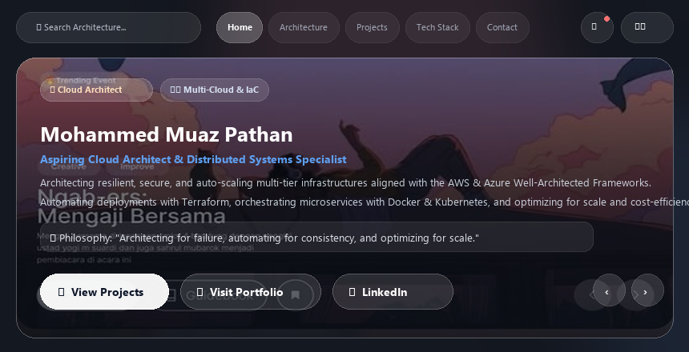
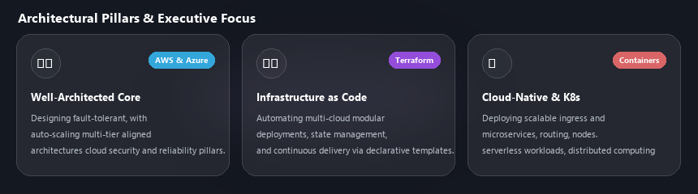
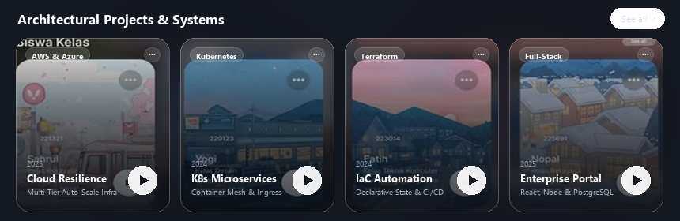
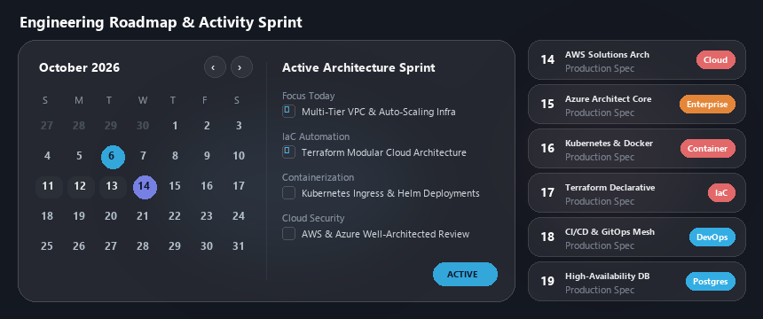

<!-- ========================================== -->
<!-- 🌟 GLASSMORPHISM UI - HERO & NAVIGATION BAR -->
<!-- ========================================== -->

  

 

<!-- ========================================== -->
<!-- 🚀 QUICK GLASS NAVIGATION DOCK            -->
<!-- ========================================== -->

  &nbsp;&nbsp;
  &nbsp;&nbsp;
  &nbsp;&nbsp;
  

 

---

<!-- ========================================== -->
<!-- 🏛️ ARCHITECTURAL PILLARS & EXECUTIVE FOCUS -->
<!-- ========================================== -->

  

 

---

<!-- ========================================== -->
<!-- 🧪 ARCHITECTURAL PROJECTS & SYSTEMS        -->
<!-- ========================================== -->

  

 

---

<!-- ========================================== -->
<!-- 🛠️ TECH STACK & CLOUD ECOSYSTEM            -->
<!-- ========================================== -->

  <h3>🛠️ Tech Stack & Ecosystem</h3>
   

  <!-- Row 1: Cloud & Core Languages (Image 1 Badges) -->
  
  
  
  
  
  
  
  
  
    
  <!-- Row 2: Frameworks, Databases & Tools (Image 1 Badges) -->
  
  
  
  
  
  

 

<!-- Frosted Skillicons Tray -->

   
   
   

 

---

<!-- ========================================== -->
<!-- 📅 ROADMAP & SPRINT CALENDAR (JADWAL)      -->
<!-- ========================================== -->

  

 

---

<!-- ========================================== -->
<!-- 🧲 REACH ME ON (Image 2 Badges)            -->
<!-- ========================================== -->

  <h3>🧲 Reach Me on:</h3>
   
  &nbsp;&nbsp;
  &nbsp;&nbsp;
  &nbsp;&nbsp;
  

  

<!-- ========================================== -->
<!-- 💰 SUPPORT ME                              -->
<!-- ========================================== -->

  

  ✨ Designed with <strong>Glassmorphism UI</strong> by <a href="https://github.com/muazpathan"><strong>@muazpathan</strong></a>

