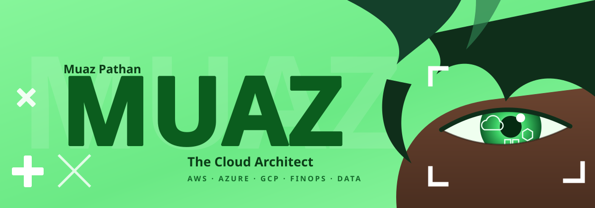
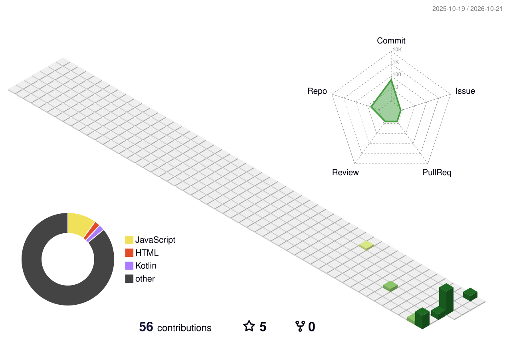

<p align="center">
  
</p>

<p align="center">
  <a href="https://muazpathan.vercel.app">
    
  </a>
</p>

<p align="center">
  
</p>

<!-- 3D CONTRIBUTION GRAPH (PRESERVED) -->
<p align="center">
  
</p>

---

## STATUS MATRIX 

```yaml
operator:
  name: "Muaz Pathan"
  tagline: "The Cloud Architect"
  status: "ONLINE ● building in public"

target_roles:
  - Cloud Solutions Architect
  - Systems & Data Engineering
  - FinOps Governance

stack:
  cloud: [AWS, Azure, GCP]
  infra: [Docker, Kubernetes, Terraform]
  code:  [Python, Go, Node.js]
  data:  [PostgreSQL, Redis]
```

---

##  TECH ARSENAL 

<p align="center">
  <b>Cloud</b><br>
  <br><br>
  <b>Infrastructure &amp; DevOps</b><br>
  <br><br>
  <b>Languages &amp; Runtimes</b><br>
  <br><br>
  <b>Data</b><br>
  
</p>

---

## METRICS

<table align="center" width="100%">
  <tr>
    <td width="50%" align="center">
      
    </td>
    <td width="50%" align="center">
      
    </td>
  </tr>
</table>

<p align="center">
  
</p>

---

## DOCKING BAY

<p align="center">
  <a href="https://muazpathan.vercel.app"></a>
  <a href="https://www.linkedin.com/in/muaz-pathan"></a>
  <a href="https://github.com/muazpathan"></a>
  <a href="mailto:YOUR_EMAIL@gmail.com"></a>
  <a href="https://instagram.com/muazz_pathann"></a>
</p>

<p align="center">
  
</p>
