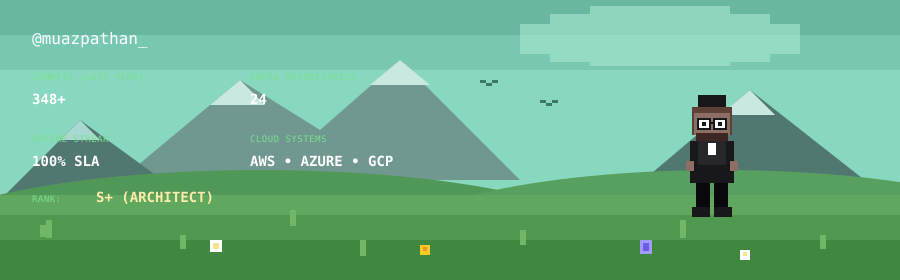

  

<!-- TOP NAVIGATION APP TILES -->
&nbsp;&nbsp;
&nbsp;&nbsp;
&nbsp;&nbsp;
&nbsp;&nbsp;

 

---

### 👨‍💻 Executive Summary & Core Mandate

> BCA Student and aspiring Cloud Architect specializing in multi-region infrastructure design, enterprise migration, zero-downtime microservices deployments, and automated cloud governance. Focused on maximizing high availability (99.99% SLAs), strictly enforcing Zero-Trust security policies, and optimizing cloud spend through comprehensive FinOps practices.

* 🔭 **I’m currently working on**: Multi-cloud infrastructure orchestration via **Terraform Enterprise**, autoscaling **Kubernetes (EKS/GKE/AKS)** clusters, and GitOps delivery pipelines.
* 👯 **I’m looking to collaborate on**: Production-grade Cloud-Native tools, distributed message brokers, and enterprise-grade IaC modules.
* 🤝 **I’m looking for help with**: Advanced eBPF-based kernel observability and large-scale multi-region FinOps automated chargeback models.
* 🌱 **I’m currently learning**: Istio Service Mesh policy topologies, OpenTelemetry distributed tracing at scale, and Chaos Engineering.
* 💬 **Ask me about**: AWS / Azure / GCP architectures, Docker, Kubernetes, Terraform, microservices, Linux kernel tuning, and Site Reliability Engineering (SRE).
* ⚡ **Fun fact**: *"There is no cloud; it's just someone else's computer... until the first invoice drops."*

 

---

### 🛠️ Technologies & Platforms

<!-- Row 1: Cloud Providers & Edge Platforms -->

 

<!-- Row 2: Infrastructure as Code, Containers, Orchestration & Web Servers -->

 

<!-- Row 3: Core Programming Languages & Core Web -->

 

<!-- Row 4: Backend Runtimes, Microservice Frameworks & Styling -->

 

<!-- Row 5: Databases, Caching & Storage Engines -->

 

<!-- Row 6: Developer Tooling, Version Control & Design -->

### 📊 Real-Time GitHub Analytics

  <table border="0">
    <tr>
      <td>
        
      </td>
      <td>
        
      </td>
    </tr>
  </table>

   

  

 

---

### 🧲 Contact

&nbsp;&nbsp;
&nbsp;&nbsp;
&nbsp;&nbsp;
&nbsp;&nbsp;

  

<picture>
  <source media="(prefers-color-scheme: dark)" srcset="https://capsule-render.vercel.app/api?type=rect&color=0:111827,100:000000&height=40&section=footer" />
  
</picture>

© Muaz Pathan • BCA Student & Aspiring Cloud Architect

